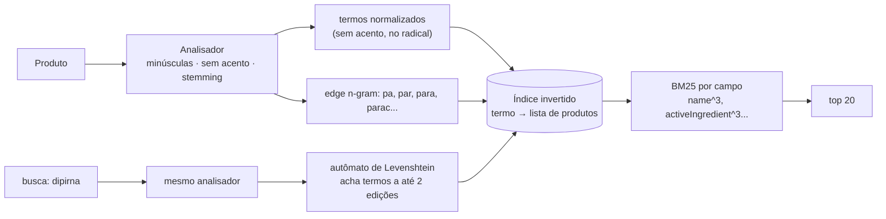
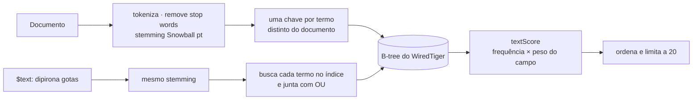
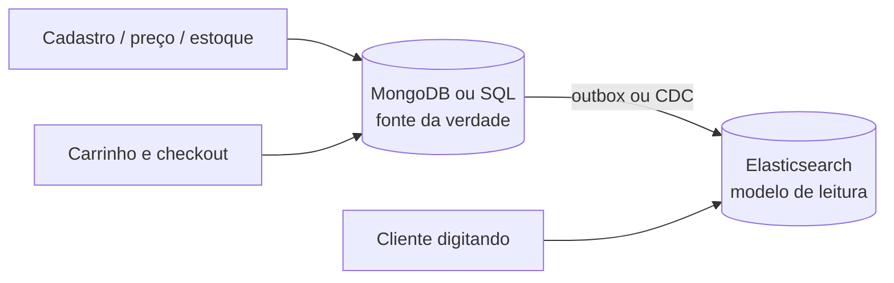

# 🔎 Benchmark .NET: Elasticsearch vs. MongoDB na busca de produtos

[](https://github.com/LuisEduJulio/dotnet-product-search-benchmark/actions/workflows/benchmark.yml)

O cliente digita na busca da farmácia. Quem responde melhor: **Elasticsearch** ou **MongoDB**?

Este repositório mede as duas coisas que importam numa vitrine: **velocidade** (requisições por segundo e
p50/p95/p99 com 50 chamadas simultâneas) e **qualidade da resposta** (o produto certo aparece na página?).
Mesmo catálogo, mesma máquina, mesma memória e o mesmo contrato de API para todos. Os resultados são gerados
pelo GitHub Actions a cada push em [`results/BENCHMARK.md`](results/BENCHMARK.md).

## Cenário

Catálogo fictício de uma rede de farmácias com **100 mil produtos** (medicamentos, vitaminas, dermocosméticos
e higiene), gerado com semente fixa. Como o catálogo é sempre o mesmo, cada busca tem **gabarito**: sabemos de
antemão quais produtos são a resposta certa.

| Cenário | O cliente digita | Resposta certa |
|---|---|---|
| Termo exato | `dipirona` | produtos de dipirona |
| Dois termos | `dipirona gotas` | dipirona **e** em gotas |
| Sem acento | `acido acetilsalicilico` | Ácido Acetilsalicílico |
| Erro de digitação | `dipirna` | produtos de dipirona |
| Autocomplete | `paracet` | produtos de paracetamol |
| Termo + filtro | `vitamina c` em *Vitaminas e Suplementos* | Vitamina C dessa categoria |

**Precisão:** quantos dos itens devolvidos são a resposta certa.
**Cobertura:** quanto da página de 20 itens foi preenchida com respostas certas.

Antes de medir, os testes de integração conferem que **os três motores devolvem o mesmo contrato JSON**.

## 🏆 Resultado

Catálogo de 100 mil produtos, 2.000 chamadas por cenário e motor, 50 simultâneas. Números do GitHub Actions
(4 núcleos, .NET 8, Elasticsearch 8.15.3 e MongoDB 7.0.45 com 1 GB de memória cada).

> **Números citados no post do LinkedIn:** execução de 05/11/2026 às 12:45 UTC, salva em
> [`results/2026-11-05-1245-utc.md`](results/2026-11-05-1245-utc.md). Cada nova execução do pipeline atualiza
> [`results/BENCHMARK.md`](results/BENCHMARK.md); os valores variam um pouco entre execuções (máquina compartilhada do
> GitHub Actions), mas a ordem e a escala das diferenças se mantêm.

### Acertou a resposta? (precisão nos 20 primeiros itens)

| Cenário | Elasticsearch | MongoDB `$text` | MongoDB `$regex` |
|---|---:|---:|---:|
| `dipirona` | 100% | 100% | 100% |
| `dipirona gotas` | 100% | 100% | 100% |
| `acido acetilsalicilico` | 100% | 100% | 100% |
| `dipirna` (erro de digitação) | **100%** | 0 itens | 0 itens |
| `paracet` (autocomplete) | **100%** | 0 itens | 100% |
| `vitamina c` + categoria | 100% | 100% | **45%** |
| **Cenários 100% certos** | **6 de 6** | 4 de 6 | 4 de 6 |

### Velocidade (requisições/s com 50 simultâneas)

| Cenário | Elasticsearch | MongoDB `$text` | MongoDB `$regex` |
|---|---:|---:|---:|
| `dipirona` | 323 | 207 | 1.164 |
| `dipirona gotas` | 285 | **48** | 839 |
| `acido acetilsalicilico` | 188 | 182 | 1.630 |
| `dipirna` | 630 | 6.856 (sem resultado) | **26** (sem resultado) |
| `paracet` | 539 | 6.499 (sem resultado) | 2.015 |
| `vitamina c` + categoria | 391 | 76 | 4.880 (45% certo) |

Sem concorrência (BenchmarkDotNet), uma busca por `dipirona` levou 4,0 ms no Elasticsearch, 7,2 ms no `$text`
e 1,3 ms no `$regex`.

### Por que o `$regex` parece o mais rápido

É efeito do `LIMIT 20`. O `$regex` lê produto por produto (`COLLSCAN`) e **para quando junta 20**. Para um termo
comum como "dipirona" (cerca de 3% do catálogo), isso acontece depois de algumas centenas de documentos. Quando o
termo não existe, ele precisa ler **os 100 mil**: `dipirna` caiu para 26 req/s, com p50 de 1,9 s, e ainda voltou
vazio. E como não há nota de relevância, em `vitamina c` o "c" casou com qualquer palavra e só 45% dos itens eram
Vitamina C.

### Por que o `$text` cai com dois termos

Para ordenar por `textScore`, o MongoDB precisa encontrar e pontuar **todos** os documentos que batem antes de
devolver os 20 primeiros. Com "dipirona gotas" virando OU, entram todas as dipironas e todos os produtos em gotas:
48 req/s. Quando o termo não existe, a busca no índice termina na hora (6.856 req/s), mas volta vazia.

### Por que o Elasticsearch fica estável

O custo foi pago na indexação: termos normalizados, prefixos já indexados e listas de documentos por termo. A
consulta lê só as listas dos termos pesquisados e o Lucene mantém apenas os 20 melhores enquanto percorre. Foi o
único com a resposta certa nos 6 cenários, entre 188 e 630 req/s.

## As estratégias

| | Como busca | Prós | Contras |
|---|---|---|---|
| **Elasticsearch** | índice invertido (Lucene), nota BM25, `fuzziness: AUTO`, subcampo de autocomplete (edge n-gram) | relevância, erro de digitação, prefixo, acento e filtros sem custo extra na nota | mais uma peça na infraestrutura; o dado leva ~1 s para aparecer na busca |
| **MongoDB `$text`** | índice de texto com stemming em português, ordenado por `textScore` | já vem no banco, resolve acento, sem infraestrutura nova | palavras viram OU, sem erro de digitação, sem prefixo, um índice de texto por coleção |
| **MongoDB `$regex`** | "contém" num campo já sem acento: o `LIKE '%termo%'` | acha pedaço de palavra, fácil de entender | lê todos os documentos (ou todas as chaves do índice) e não tem nota de relevância |

## Por baixo dos panos

### Elasticsearch: o trabalho pesado acontece na escrita



1. **Análise na indexação.** Cada campo de texto passa por um analisador (`pt_folded`): quebra em palavras,
   deixa minúsculo, tira acento (`asciifolding`) e reduz a palavra ao radical (`light_portuguese`). "Ácido" e
   "acido" viram o mesmo termo antes de chegar no índice.
2. **Índice invertido.** Para cada termo, o Lucene guarda a lista dos documentos que o contêm (*posting list*).
   Buscar "dipirona" não percorre produtos: vai direto no termo e lê a lista.
3. **Erro de digitação.** Com `fuzziness: AUTO`, o termo pesquisado vira um autômato de Levenshtein que percorre
   o dicionário de termos e aceita até 1 edição (palavras de 3 a 5 letras) ou 2 edições (6 ou mais).
   "dipirna" encontra "dipirona" com uma letra a menos.
4. **Autocomplete.** O subcampo `name.autocomplete` indexa os prefixos de cada palavra (edge n-gram de 2 a 15
   letras). "paracet" vira uma busca exata por um termo que já existe no índice. O custo vai para o tamanho do
   índice, não para a consulta.
5. **Relevância.** Cada produto recebe uma nota BM25: termo raro vale mais que termo comum, e campo curto vale mais
   que campo longo. Os pesos (`name^3`, `activeIngredient^3`, `brand^2`) fazem o nome pesar mais que a descrição.
6. **Filtro sem nota.** A categoria vai no `filter` do `bool`: restringe o resultado sem mexer na nota, e o
   Elasticsearch pode reaproveitar esse filtro em cache entre consultas.
7. **Near real-time.** O que é gravado fica num buffer e só vira um segmento pesquisável no *refresh* (1 s por
   padrão). Os segmentos são imutáveis e são unidos em segundo plano (*merge*). Por isso o Elasticsearch é ótimo
   para ler e não deve ser a fonte da verdade.

### MongoDB `$text`: índice de texto dentro do B-tree



1. **Índice de texto.** Na gravação, o MongoDB quebra o texto, remove stop words do português, reduz ao radical
   (Snowball) e grava **uma chave por termo distinto** do documento no B-tree, como um índice *multikey*. A versão 3
   do índice já ignora maiúsculas e acentos.
2. **Consulta.** O `$text` passa a busca pelo mesmo processo e procura cada termo no índice. Vários termos viram
   **OU**: "dipirona gotas" traz quem tem qualquer um dos dois, e quem tem os dois tende a ficar no topo pela nota.
   Para exigir os dois, cada termo precisa ir entre aspas.
3. **Sem tolerância.** O termo precisa existir exatamente (depois do stemming). Não há busca por prefixo nem por
   distância de edição: "dipirna" e "paracet" não encontram nada.
4. **Nota.** O `textScore` considera quantas vezes o termo aparece e o peso de cada campo (`weights`). Para
   ordenar pela nota é preciso projetar e ordenar por `{ $meta: "textScore" }`.
5. **Consistência.** A escrita confirmada já aparece na próxima leitura. É o mesmo banco da fonte da verdade.

### MongoDB `$regex`: o `LIKE '%termo%'`

1. Cada palavra pesquisada vira um `$regex` sem âncora no campo `searchText` (nome, princípio ativo, marca e
   categoria, já sem acento).
2. Sem índice, o plano é `COLLSCAN`: o MongoDB lê **todos os documentos** e testa a expressão em cada um.
   Com índice no campo, um regex sem `^` no começo ainda percorre **todas as chaves** do índice.
3. Acha pedaço de palavra ("paracet"), mas não tem nota: devolve na ordem em que encontrar. E "c" em
   "vitamina c" casa com qualquer palavra que tenha a letra c.

## Qual escolher em cada contexto

| Contexto | Melhor opção | Por quê |
|---|---|---|
| Busca da vitrine e do app (autocomplete, erro de digitação, relevância) | **Elasticsearch** | índice invertido, fuzziness, n-gram e BM25 foram feitos para isso |
| Já está no MongoDB Atlas e quer evitar outra peça | **Atlas Search** | também usa Lucene por baixo, integrado ao Atlas (fora desta comparação) |
| Catálogo pequeno, busca por palavra inteira, sem infraestrutura nova | **MongoDB `$text`** | resolve acento e stemming de graça, no mesmo banco |
| Busca por SKU, EAN ou código interno | **índice normal no banco principal** | é igualdade exata; busca textual não acrescenta nada |
| Preço e estoque no carrinho e no checkout | **banco principal** | precisa estar certo agora; o Elasticsearch fica ~1 s atrás |
| Tela administrativa com pouco acesso | **`$regex`** aceitável | simples; o custo de ler tudo não pesa com pouco volume |

### Na prática: os dois juntos



O banco principal continua dono do dado. O Elasticsearch recebe uma cópia pensada para busca, atualizada por
eventos (outbox ou CDC). É o mesmo CQRS de leitura do
[laboratório de produto cartesiano](https://github.com/LuisEduJulio/dotnet-cartesian-explosion-concurrency).

## Duas medições

1. **Teste de carga:** 2.000 chamadas por cenário e motor, 50 simultâneas, depois de 50 chamadas de aquecimento.
   Mede requisições/s, p50, p95, p99, erros, precisão e cobertura.
2. **BenchmarkDotNet:** latência e memória por chamada, uma de cada vez, 15 iterações por caso.

Os dois bancos rodam no mesmo runner do GitHub Actions, com 1 GB de heap para o Elasticsearch e 1 GB de cache
para o MongoDB. Os números servem para comparar um com o outro, não como capacidade de produção.

## Arquitetura (DDD + Clean Architecture)

```
PharmaSearch.sln
├── src
│   ├── PharmaSearch.Domain                      Aggregate Product, value objects Sku e SearchTerm, DomainException
│   ├── PharmaSearch.Application                 portas IProductSearchEngine / IProductCatalogWriter,
│   │                                            casos de uso SearchProductsHandler e IndexCatalogHandler
│   ├── PharmaSearch.Infrastructure.Elasticsearch adapter via API REST (HttpClient), mapeamento e Bulk API
│   ├── PharmaSearch.Infrastructure.Mongo        adapters $text e $regex, índices e modelo de persistência
│   ├── PharmaSearch.Seeding                     catálogo determinístico, cenários e gabarito
│   └── PharmaSearch.Api                         Minimal API: GET /products/search?engine=Elasticsearch&q=dipirna
├── tests
│   ├── PharmaSearch.UnitTests                   domínio, caso de uso, consulta do Elasticsearch e catálogo
│   └── PharmaSearch.IntegrationTests            API + Elasticsearch + MongoDB reais, mesmo contrato JSON
└── benchmarks/PharmaSearch.Benchmarks           teste de carga + BenchmarkDotNet
```

As dependências apontam para dentro: `Api → Infrastructure → Application → Domain`. Cada motor é um adapter
da mesma porta `IProductSearchEngine` (OCP/LSP), leitura e escrita ficam em portas separadas (ISP) e só a API
conhece as implementações (DIP). Trocar de motor é trocar um adapter, sem tocar no caso de uso.

O Elasticsearch é acessado pela API REST com `HttpClient`, sem SDK, para a query DSL ficar visível em
[`ElasticsearchProductSearchEngine`](src/PharmaSearch.Infrastructure.Elasticsearch/ElasticsearchProductSearchEngine.cs).

## Como rodar

```bash
docker compose up -d --wait                         # Elasticsearch 8.15 + MongoDB 7.0
dotnet build PharmaSearch.sln
dotnet test                                         # unidade + integração

dotnet run --project src/PharmaSearch.Api
curl -X POST "http://localhost:5000/catalog/seed?count=100000"
curl "http://localhost:5000/products/search?engine=Elasticsearch&q=dipirna"
curl "http://localhost:5000/products/search?engine=MongoText&q=dipirna"

dotnet run -c Release --project benchmarks/PharmaSearch.Benchmarks -- --load --requests 2000 --concurrency 50 --out results/LOAD.md
dotnet run -c Release --project benchmarks/PharmaSearch.Benchmarks -- --filter '*'
```

## O que levar para a busca de produtos

1. **Busca de vitrine é problema de índice invertido.** Erro de digitação, prefixo e relevância não saem de graça de um B-tree.
2. **Meça a qualidade, não só o tempo.** Uma busca rápida que devolve vazio para "dipirna" é venda perdida.
3. **Normalize na escrita.** Acento, maiúscula e radical resolvidos na indexação deixam a consulta barata.
4. **Fonte da verdade e modelo de leitura são papéis diferentes.** Grave no banco, busque no índice, sincronize por evento.
5. **`LIKE '%termo%'` não escala.** Ele lê tudo a cada busca e não sabe o que é mais relevante.

---

Feito por Luis Eduardo · .NET · Elasticsearch · MongoDB · arquitetura de software
